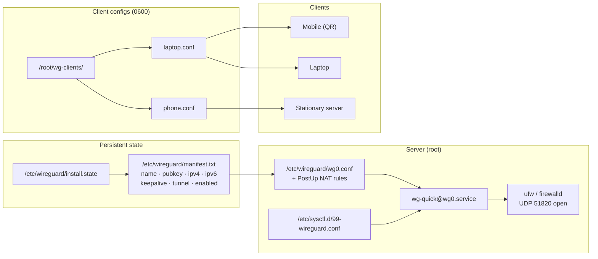

# SLICEisGuard

**Modern WireGuard server installer with multi-client management and per-peer cost control.**

Installs WireGuard, generates keys, writes server and client configs, enables
IP forwarding, opens the firewall, and starts the systemd service — in one
command. Add, remove, enable, disable, and inspect clients with dedicated
subcommands. Per-client keepalive and split-tunnel options keep operating
cost low without giving up the always-on tunnel.

**Maintained by [`D0T_SL_CE'I_`](https://github.com/)**

> *SL_CE'I_ → SLICE'IS → "Slice is" → **Internet Security**, by design.*
> The two letters hidden behind the underscores spell **IS**.

[](#changelog)
[](#license)
[](#requirements)
[](#)

> ### ⚠️ Defensive tooling only
>
> This script configures the local host's own WireGuard server. It does not
> scan, probe, or send traffic to any remote host. It is a deployment tool,
> not an attack tool.

---

## Table of contents

- [What it does](#what-it-does)
- [Why the name](#why-the-name)
- [The cost model](#the-cost-model)
- [Architecture](#architecture)
- [Features](#features)
- [Requirements](#requirements)
- [Install](#install)
- [Usage](#usage)
- [Subcommands](#subcommands)
- [Per-client options](#per-client-options)
- [Configuration reference](#configuration-reference)
- [Files created](#files-created)
- [WSL integration](#wsl-integration)
- [Security considerations](#security-considerations)
- [Troubleshooting](#troubleshooting)
- [Changelog](#changelog)
- [Credits](#credits)
- [License](#license)

---

## What it does

```
┌─────────────────────┐     ┌──────────────────┐     ┌──────────────────────┐
│    SLICEisGuard     │────▶│      wg0.conf    │────▶│ wg-quick@wg0.service │
│       (script)      │     │  + client configs│     │      (systemd)       │
└─────────────────────┘     └──────────────────┘     └──────────────────────┘
         │                            │                         │
         ▼                            ▼                         ▼
  * package install            * server keys               * IP forwarding
  * OS detection               * client keys               * UDP port open
  * input validation           * PSK (optional)            * interface up
  * firewall open              * QR codes                  * health check
  * backup rotation            * split / full tunnel       * per-peer stats
```

On `install`, the script:

1. Detects the OS (Debian, Ubuntu, Fedora, RHEL/Rocky/Alma, Arch).
2. Installs `wireguard-tools`, `iptables`, and `qrencode`.
3. Detects your public IPv4/IPv6 and default interface (pre-fills prompts).
4. Prompts for interface name, WireGuard subnet, port, DNS, and PSK choice.
5. Generates the server key pair.
6. Writes `/etc/wireguard/wg0.conf` with full PostUp/PostDown NAT rules for
   IPv4 **and** IPv6, and `SaveConfig = false` so the script owns the file.
7. Persists IP forwarding in `/etc/sysctl.d/99-wireguard.conf`.
8. Opens UDP `$SERVER_PORT` in `ufw` or `firewalld` if either is active.
9. Enables and starts `wg-quick@wg0` and verifies the interface came up.
10. Adds the first client, writes its config to `/root/wg-clients/`, and
    prints a QR code.

After install, the tunnel stays up. There is **no idle shutdown** — that
design choice is explained in [The cost model](#the-cost-model).

---

## Why the name

**SLICEisGuard** is a phonetic expansion of the author's tag `SL_CE'I_`:

| Form | Reading |
|---|---|
| `SL_CE'I_` | The tag — two underscores hide two letters |
| `SLICE'IS` | Expanded — the hidden letters are **I** and **S** |
| "Slice is" | Phonetic — reads as the English words |
| **I**nternet **S**ecurity | What the hidden IS stands for |
| SLICEisGuard | The product — "Slice is Guard" |

The GitHub slug is `SLICEisGuard` (no apostrophe, no quotes) because GitHub
only accepts alphanumerics, hyphens, underscores, and periods in repo URLs.
Everywhere a human reads the name — title, badges, footer, docs — the full
tag `SL_CE'I_` is preserved.

---

## The cost model

WireGuard is **already reactive**. This section explains why the tunnel is
left up rather than shut down when idle, so that decision doesn't get
re-litigated every six months.

### Idle cost of a running tunnel

| Resource | Idle cost | Why |
|---|---|---|
| **CPU** | ~0% | Kernel module, event-driven, no polling |
| **Memory** | ~few KB/peer | Routing state only |
| **Bandwidth (no keepalive)** | **0 bytes** | Nothing is sent if nothing needs sending |
| **Bandwidth (`PersistentKeepalive = 25`)** | ~100 bytes/min/peer | Negligible on all but metered mobile links |

A running tunnel with `PersistentKeepalive = 0` costs **exactly zero
bandwidth** when idle. The "constant operation" cost is a myth for
WireGuard — there is no heartbeat unless you ask for one.

### Where cost actually comes from

If you have a bandwidth bill, it is coming from one of these, not from the
tunnel being up:

| Source | Fix in this installer |
|---|---|
| Full-tunnel routing (`AllowedIPs = 0.0.0.0/0`) sending streaming, updates, backups through the server | `--split-tunnel` on `add-client` routes only server subnets |
| `PersistentKeepalive` on stationary peers (servers, desktops) | `--keepalive 0` on `add-client` |
| MTU mismatch causing fragmentation | Not automated; set `MTU = 1420` manually if you see fragmentation |
| DNS through the tunnel for every query | Use a resolver in the tunnel subnet, or set client DNS to a public resolver outside the tunnel for non-privacy cases |
| No visibility into which peer is costing you | `sliceguard stats` shows per-peer RX/TX |

### Why no shutdown-when-idle wrapper

A wrapper that `wg-quick down`s after N minutes of no traffic **costs more
than it saves** in most cases:

- Every reconnect is a full handshake (~200 ms + a small packet burst).
- Mobile clients treat a downed tunnel as a connectivity failure and retry
  aggressively — you get worse battery life, not better.
- The wrapper itself polls to decide "is it idle?", which is exactly the
  constant-operation cost you were trying to avoid.
- The "reactive" pattern works for HTTP/SSE because the server can hold a
  connection open and the client can drop it cheaply. It does not work for
  VPN tunnels.

If you genuinely need to zero the idle cost, use `--keepalive 0` on stationary
peers. That gets you to **exactly zero** idle bandwidth with no wrapper, no
polling, and no reconnect penalty.

---

## Architecture



### Flow on `add-client`

```mermaid
sequenceDiagram
    participant U as Operator
    participant S as sliceguard
    participant M as manifest
    participant C as wg0.conf
    participant W as wg kernel

    U->>S: add-client laptop --keepalive 25 --split-tunnel
    S->>M: read existing peers
    S->>S: pick next IP .2 and ::2
    S->>S: wg genkey; wg pubkey
    S->>S: wg genpsk if PSK enabled
    S->>C: append new Peer block
    S->>M: record peer row
    S->>S: render client config, chmod 0600
    S->>W: wg set wg0 peer with allowed-ips
    S->>U: print config and QR code
```
No interface restart. The peer is added live via `wg set`, so existing
clients never lose their session when a new one joins.

---

## Features

| Category | Feature |
|---|---|
| **Correctness** | Client private key file `chmod 0600` |
| | `set -euo pipefail` + `umask 077` |
| | Input validation on every field |
| | Default port `51820` (WireGuard convention) |
| | Default DNS `1.1.1.1 / 1.0.0.1` (Cloudflare) |
| **Cost control** | Per-client `PersistentKeepalive` — `25` for NAT'd peers, `0` for stationary |
| | Per-client tunnel type — full / split / custom `AllowedIPs` |
| | `stats` subcommand for per-peer RX/TX and handshake age |
| | `disable-client` / `enable-client` — pause without deleting |
| **Networking** | Full IPv4 + IPv6 PostUp/PostDown NAT rules |
| | IP forwarding persisted to `/etc/sysctl.d/99-wireguard.conf` |
| | Firewall opened automatically (`ufw` or `firewalld`) |
| | Firewall closed on `uninstall` |
| | Health check after start |
| **Client management** | `add-client`, `remove-client`, `enable-client`, `disable-client` |
| | `list-clients`, `show-client`, `stats` |
| | Auto-assign next available IPv4/IPv6 |
| | Live peer add/remove via `wg set` |
| | QR code generation for mobile clients |
| **Safety** | `SaveConfig = false` — script owns the config, `wg-quick down` won't overwrite |
| | Backup existing configs before overwrite, keep last 5 |
| | Confirm before uninstall |
| | `uninstall` removes config, firewall rule, sysctl, state, and client files |
| **Modernisation** | No PPA, no unstable repo, no copr |
| | Kernel 5.6+ uses the in-tree module |
| | Rocky / AlmaLinux / RHEL 8+ supported |
| | `DEBIAN_FRONTEND=noninteractive` for apt |
| **Support** | Coloured output, `--version`, `--help` |
| | Author attribution in header, config comment, and `--version` |

---

## Requirements

| Component | Minimum | Notes |
|---|---|---|
| Linux kernel | **5.6+** | WireGuard is in-tree since 5.6. Older kernels need `wireguard-dkms` (not covered) |
| `bash` | 4.3+ | `set -euo pipefail`, arrays |
| **systemd** | any | Service is `wg-quick@<iface>.service` |
| `iptables` | any | `iptables-nft` on modern distros works transparently |
| `wg` / `wg-quick` | 1.0+ | Installed by the script |
| `qrencode` | optional | QR codes; falls back to text output if absent |
| `ufw` or `firewalld` | optional | Port opened automatically if active |

### Supported distributions

| Family | Versions |
|---|---|
| Debian | 11 (Bullseye), 12 (Bookworm), 13 (Trixie) |
| Ubuntu | 20.04, 22.04, 24.04, 24.10 |
| Fedora | 38+ |
| RHEL family | RHEL 8, RHEL 9, Rocky 8/9, AlmaLinux 8/9 |
| Arch | rolling |

Anything with systemd and kernel 5.6+ should work. OpenVZ and LXC are
explicitly refused (kernel module is on the host, not in the container).

---

## Install

```bash
# As root on the server:
sudo ./SLICEisGuard.sh install
```

The installer is **interactive**. It will prompt for:

| Prompt | Default | Notes |
|---|---|---|
| Public address (IPv4 or IPv6) | auto-detected | What clients connect to |
| Public interface | auto-detected | The NIC with the default route |
| WireGuard interface name | `wg0` | Must match `[a-zA-Z0-9_-]{1,15}` |
| Server WireGuard IPv4 | `10.66.66.1` | Inside the tunnel |
| Server WireGuard IPv6 | `fd42:42:42::1` | Inside the tunnel |
| WireGuard UDP port | `51820` | Open in firewall automatically |
| Client primary DNS | `1.1.1.1` | Cloudflare |
| Client secondary DNS | `1.0.0.1` | Cloudflare |
| Use pre-shared key | `Y` | Adds post-quantum resistance for symmetric phase |
| First client name | `client1` | Any alnum/-/_ up to 32 chars |

After install:

- Server config: `/etc/wireguard/wg0.conf` (mode `0600`)
- First client config: `/root/wg-clients/client1.conf` (mode `0600`)
- Service: `wg-quick@wg0.service` — enabled and running
- Firewall: UDP `51820` open
- Sysctl: `/etc/sysctl.d/99-wireguard.conf`

---

## Usage

```text
SLICEisGuard.sh <command> [args]

Commands:
  install                     Install WireGuard and add the first client
  add-client <name> [opts]    Add a new client (see Per-client options)
  remove-client <name>        Remove a client permanently
  disable-client <name>       Pause a client (keeps config, removes from kernel)
  enable-client <name>        Re-enable a disabled client
  list-clients                List all clients
  show-client <name>          Show client config and QR code
  stats                       Per-peer transfer, handshake age, keepalive
  uninstall                   Remove config and firewall rules
  version                     Print version
  help                        Print this help
```

### Typical workflows

**Add a laptop (mobile, full tunnel, default keepalive):**

```bash
sudo ./SLICEisGuard.sh add-client laptop
# Output includes the config and a QR code.
```

**Add a stationary server (no keepalive, split tunnel):**

```bash
sudo ./SLICEisGuard.sh add-client homeserver --keepalive 0 --split-tunnel
# Idle cost: exactly zero bytes. Only server-subnet traffic is routed.
```

**Add a device with custom routing:**

```bash
sudo ./SLICEisGuard.sh add-client office --allowed-ips "192.168.1.0/24,10.0.0.0/8"
```

**Pause a peer without deleting it:**

```bash
sudo ./SLICEisGuard.sh disable-client laptop
# Peer removed from kernel and config. Client config file kept for re-enable.
```

**Re-enable it later:**

```bash
sudo ./SLICEisGuard.sh enable-client laptop
# Peer re-added to config and kernel using its saved keys.
```

**Check what each peer costs you:**

```bash
sudo ./SLICEisGuard.sh stats
```

```
NAME                 RX           TX           LATEST HANDSHAKE  KEEPALIVE  ENABLED
----                 --           --           ----------------  ---------  -------
laptop               1.24 MiB     340.00 KiB   12s ago           25s        yes
phone                45.00 MiB    8.20 MiB     3m ago            25s        yes
homeserver           3.40 GiB     1.80 GiB     8s ago            0s         yes

TOTAL                3.48 GiB     1.83 GiB
```

**Copy config to a client machine:**

```bash
# From the client:
scp root@server:/root/wg-clients/laptop.conf ~/wg0.conf
sudo install -m 0600 ~/wg0.conf /etc/wireguard/wg0.conf
sudo wg-quick up wg0
```

**Revoke a stolen device:**

```bash
sudo ./SLICEisGuard.sh remove-client laptop
# Peer removed from kernel immediately via wg set.
# Config, manifest entry, and client file are removed.
```

---

## Subcommands

### `install`

Full interactive installer. Safe to re-run — if configs exist, it offers to
back them up (`*.bak.<timestamp>`) and keeps the last 5 backups per file.

### `add-client <name> [options]`

| Option | Default | Notes |
|---|---|---|
| `--keepalive N` | `25` | `0` disables keepalive (stationary peers) |
| `--full-tunnel` | (default) | `AllowedIPs = 0.0.0.0/0, ::/0` |
| `--split-tunnel` | — | `AllowedIPs` = server's v4/v6 subnets only |
| `--allowed-ips CIDRS` | — | Custom comma-separated `AllowedIPs` |
| `--non-interactive` | — | Skip prompts; use flags or defaults |

- Validates the name (`^[a-zA-Z0-9_-]{1,32}$`)
- Assigns the next free IPv4/IPv6 in the tunnel subnet
- Generates a fresh key pair, plus PSK if enabled at install time
- Appends a `[Peer]` block to the server config
- Records the peer in `manifest.txt` (8 fields, v2.1 format)
- Writes `/root/wg-clients/<name>.conf` (mode `0600`)
- Adds the peer to the running interface via `wg set` (**no restart**)
- Prints the config and a QR code

### `remove-client <name>`

- Removes the peer from the kernel via `wg set ... remove`
- Strips the `[Peer]` block from the server config (keyed `awk`)
- Removes the entry from `manifest.txt`
- Deletes `/root/wg-clients/<name>.conf`
- **Does not touch the running interface's other peers**

### `disable-client <name>`

- Removes the peer from the kernel and from `wg0.conf`
- Sets `enabled=0` in the manifest
- **Keeps** `/root/wg-clients/<name>.conf` so `enable-client` can restore it
- Idempotent — running it twice is a no-op

### `enable-client <name>`

- Re-adds the `[Peer]` block to `wg0.conf` using the saved pubkey/PSK
- Adds the peer to the running interface via `wg set`
- Sets `enabled=1` in the manifest
- Idempotent

### `list-clients`

Prints the manifest as a table:

```
NAME                 IPv4             IPv6                         KEEPALIVE  ENABLED  PUBLIC KEY
----                 ----             ----                         ---------  -------  ----------
laptop               10.66.66.2       fd42:42:42::2                25         yes      aBcD...=
homeserver           10.66.66.3       fd42:42:42::3                0          yes      eFgH...=
```

### `show-client <name>`

Prints the client config file and, if `qrencode` is installed, the QR code.

### `stats`

Reads `wg show <iface> dump` and cross-references against `manifest.txt`.
Shows per-peer RX/TX (humanized), latest handshake age, keepalive, and
enabled status. Ends with a total line.

### `uninstall`

- Stops and disables `wg-quick@wg0`
- Closes UDP `51820` in the firewall
- Removes `wg0.conf` and all its `.bak.*` backups
- Removes `/root/wg-clients/`, `manifest.txt`, `install.state`, and
  `/etc/sysctl.d/99-wireguard.conf`
- **Leaves WireGuard packages installed**

Prompts for confirmation before doing anything.

---

## Per-client options

### `PersistentKeepalive`

| Value | Use for | Idle bandwidth | Behaviour |
|---|---|---|---|
| `25` | Phones, laptops, anything behind NAT | ~100 bytes/min | Keeps NAT mapping alive; tunnel survives phone sleep |
| `0` | Stationary servers, desktops on wired networks, site-to-site endpoints | **0 bytes** | No traffic when idle; first packet after idle takes ~200 ms (handshake) |

Set per-client at add time:

```bash
sudo ./SLICEisGuard.sh add-client homeserver --keepalive 0
```

You can change it later by `remove-client` + `add-client`, or by editing
`/etc/wireguard/wg0.conf` and running `wg set <iface> peer <pub> persistent-keepalive <N>`.

### Tunnel type

| Type | `AllowedIPs` sent to the client | Bandwidth through server |
|---|---|---|
| `full` | `0.0.0.0/0, ::/0` | Everything the client sends |
| `split` | Server's v4 /24 and v6 /64 | Only traffic to the server subnet |
| `custom` | What you provide via `--allowed-ips` | Only the CIDRs you list |

**Full tunnel** is the right default for a privacy VPN: all traffic is
encrypted and exits from the server. **Split tunnel** is the right choice
when you only need to reach resources inside the server's network (home
lab, office LAN, cloud VPC) and want everything else to go direct. It can
cut tunneled bandwidth by 90% or more.

---

## Configuration reference

There is **no config file to edit** — everything is set at install time and
persisted to `/etc/wireguard/install.state`. The state file is `0600`:

```bash
# Managed by SLICEisGuard 2.1.0
# Do not edit manually.
SERVER_WG_NIC="wg0"
SERVER_WG_IPV4="10.66.66.1"
SERVER_WG_IPV6="fd42:42:42::1"
SERVER_PORT="51820"
SERVER_PUB_IP="203.0.113.5"
SERVER_PUB_NIC="eth0"
CLIENT_DNS_1="1.1.1.1"
CLIENT_DNS_2="1.0.0.1"
USE_PSK="y"
```

To change server parameters:

```bash
sudo ./SLICEisGuard.sh uninstall
sudo ./SLICEisGuard.sh install
```

Client parameters (DNS, AllowedIPs, Keepalive) live in each client's
`/root/wg-clients/<name>.conf` and in the manifest. Edit the client file
and re-deliver it to the client — the server does not need to change unless
you also want to change its peer entry.

### Manifest format (v2.1)

`/etc/wireguard/manifest.txt`, pipe-separated, one line per peer:

```
name|pubkey|ipv4|ipv6|keepalive|tunnel|enabled|psk
```

- `tunnel` is `full`, `split`, or a comma-separated `AllowedIPs` string
- `enabled` is `1` or `0`
- `psk` is the preshared key, or empty
- v2.0 manifests (4 fields) are auto-migrated on first run with defaults
  `keepalive=25 tunnel=full enabled=1 psk=`

---

## Files created

```text
/etc/wireguard/
├── wg0.conf                 0600  server config (keys, peers, NAT rules)
├── wg0.conf.bak.<ts>        0600  up to 5 rotated backups
├── manifest.txt             0600  name|pub|ipv4|ipv6|ka|tunnel|enabled|psk
└── install.state            0600  install-time parameters

/root/wg-clients/
├── client1.conf             0600  per-client config
├── laptop.conf              0600
└── homeserver.conf          0600

/etc/sysctl.d/99-wireguard.conf       IP forwarding (v4 + v6)
```

Nothing is written outside these paths, `iptables`/`ip6tables` rules, and
the WireGuard packages themselves.

---

## WSL integration

If you are running this installer **inside WSL 2** to expose a WireGuard
endpoint from a Windows host, additional configuration is required. WSL 2
runs in a lightweight VM with its own network namespace, and inbound traffic
does not automatically reach it.

### Scenario A — WSL as a client (recommended)

Running WireGuard as a **client** inside WSL works normally: `wg-quick up wg0`
brings up the tunnel inside the VM, and processes running in WSL route
through it. Windows processes do **not** — for system-wide VPN on Windows,
use the official WireGuard for Windows client instead. See the
[WireGuard Windows install guide](https://www.wireguard.com/install/).

### Scenario B — WSL as a server (advanced)

If you want Windows apps to be reachable over the tunnel from a remote
client, you must bridge Windows → WSL 2:

1. **Find the WSL 2 IP:**

   ```powershell
   wsl hostname -I
   ```

2. **Open the WireGuard port in Windows Firewall** (run as Administrator):

   ```powershell
   netsh advfirewall firewall add rule name="WireGuard WSL UDP" `
     dir=in action=allow protocol=UDP localport=51820 localip=<WSL_IP>
   ```

3. **Port-forward on your home router** to the Windows host's LAN IP on UDP
   `51820` — WSL 2 has no public IP of its own.

4. **Forward Windows → WSL on every boot.** The WSL 2 IP changes on restart,
   so a `netsh interface portproxy` rule must be refreshed:

   ```powershell
   # Run as Administrator after each WSL start:
   $wslIp = (wsl hostname -I).Trim().Split(' ')[0]
   netsh interface portproxy add v4tov4 `
     listenport=51820 listenaddress=0.0.0.0 `
     connectport=51820 connectaddress=$wslIp protocol=udp
   ```

   Because `netsh portproxy` has limited UDP support, most operators use a
   small relay or the official WireGuard for Windows client with the config
   generated by this installer. That is simpler and more reliable.

### WSL prerequisites

- Windows 10 build 19041+ or Windows 11
- WSL 2 enabled (`wsl --install`)
- Virtualization enabled in BIOS/UEFI
- Ubuntu 22.04 LTS or later recommended

```powershell
wsl --install
wsl --set-default-version 2
```

Inside WSL:

```bash
sudo apt update && sudo apt upgrade -y
# Then run this installer normally.
```

---

## Security considerations

### 1. Key management

- Client private keys live in `/root/wg-clients/` at mode `0600`. Only root
  can read them.
- Server private key lives in `/etc/wireguard/wg0.conf` at mode `0600`.
- **Never** copy these files to a shared location, never commit them to git,
  and never paste them into a chat or ticket.
- To rotate a client: `remove-client <name>` then `add-client <name>`. The
  new key is generated locally; nothing leaves the server.
- To rotate the server: `uninstall` then `install`. **All existing clients
  must be re-provisioned** — schedule this deliberately.

### 2. Least privilege

- The script requires root for `ipset`, `iptables`, and writing to
  `/etc/wireguard/`. There is no way to reduce that.
- Do **not** run the installer from an untrusted checkout. Read the script
  first, or verify its hash against the version you published.
- The service it creates (`wg-quick@wg0`) runs as root for the same reasons.
  Its scope is limited to network configuration.

### 3. Firewall hardening

Beyond opening UDP `51820`, restrict everything else:

```bash
# ufw example — default deny inbound, allow only SSH + WireGuard
sudo ufw default deny incoming
sudo ufw default allow outgoing
sudo ufw allow 22/tcp          # or your alternate SSH port
sudo ufw allow 51820/udp       # already done by this installer
sudo ufw enable
```

On `firewalld` systems, use a dedicated zone with only `ssh` and
`wireguard` services.

### 4. Regular updates

WireGuard itself rarely needs updating (it is in the kernel), but keep:

- The host OS patched (`apt upgrade` / `dnf upgrade`)
- `iptables` updated
- The kernel updated (WireGuard fixes ship via kernel updates)

### 5. Logging and monitoring

```bash
# Live interface state
sudo wg show

# Per-peer cost view (this installer)
sudo ./SLICEisGuard.sh stats

# Service logs
sudo journalctl -u wg-quick@wg0 -f
```

A peer whose "latest handshake" is older than 5 minutes while the service is
up is either idle or broken. A peer whose handshake keeps resetting against
an endpoint you do not recognize is a sign of key compromise — `remove-client`
that peer immediately.

### 6. DNS security

The default DNS in every client config is Cloudflare (`1.1.1.1`,
`1.0.0.1`). This is fast, stable, and does not log query bodies for more
than 24 hours.

For stricter privacy:

- Use a self-hosted resolver (Pi-hole, Unbound, AdGuard Home) as the client
  DNS. Add its tunnel IP (e.g. `10.66.66.10`) to the client config's `DNS=`.
- On Windows and macOS clients, additionally configure DNS-over-HTTPS or
  DNS-over-TLS at the OS level so queries made **outside** the tunnel are
  encrypted too. WireGuard does not encrypt DNS by itself.

Never use a DNS resolver you cannot name and trust.

### 7. Pre-shared keys (PSK)

The installer defaults to `USE_PSK=y`, generating a 32-byte symmetric key per
client and writing it into both the server `[Peer]` block and the client
`[Peer]` block. PSKs add a symmetric layer that is believed to be resistant
to post-quantum attacks on the asymmetric handshake — defence in depth, not a
replacement for key hygiene.

### 8. `SaveConfig = false`

The server config includes `SaveConfig = false`. This means
`wg-quick down wg0` will **not** overwrite `/etc/wireguard/wg0.conf` with the
live kernel state. Without this, peers added live via `wg set` and then
removed via `wg set` could lose their persisted entries after a service
restart. With it, the on-disk file is the source of truth and only this
script writes to it.

### 9. Backup rotation

On reinstall, existing configs are backed up as `wg0.conf.bak.<timestamp>`
and only the **last 5** backups are kept per file. This prevents the backup
directory from growing unbounded over years of installs.

### 10. Attack surface

The installer only touches:

- `/etc/wireguard/`
- `/etc/sysctl.d/99-wireguard.conf`
- `/root/wg-clients/`
- `iptables` and `ip6tables` NAT/FORWARD chains
- The system firewall's UDP rule for `$SERVER_PORT`

It does **not** modify SSH config, user accounts, cron jobs, or any other
service.

---

## Troubleshooting

| Symptom | Likely cause | Fix |
|---|---|---|
| `wg-quick@wg0` fails to start | `wg0.conf` syntax error | `sudo journalctl -u wg-quick@wg0 -n50` |
| Service active, no client connects | Firewall not open | `sudo ufw status` / `sudo firewall-cmd --list-ports` |
| Client connects, no internet | IP forwarding off | `sysctl net.ipv4.ip_forward` should be `1` |
| Client connects, no internet (NAT) | Missing `MASQUERADE` rule | `sudo iptables -t nat -L POSTROUTING -n -v` |
| `add-client` says "no install state" | Never ran `install` | `sudo ./SLICEisGuard.sh install` |
| IPv6 tunnel broken | `/etc/sysctl.d/99-wireguard.conf` not loaded | `sudo sysctl -p /etc/sysctl.d/99-wireguard.conf` |
| Handshake succeeds, no traffic | Wrong `AllowedIPs` on client | Check `AllowedIPs` in client config |
| Split tunnel can't reach the internet | Expected — split tunnel routes only server subnets | Use `full` tunnel if you want all traffic through the server |
| Client goes offline after 30–120 s | Keepalive is 0 on a NAT'd client | Re-add with `--keepalive 25` |
| Peer added by `wg set` disappears after restart | `SaveConfig` was `true` (v2.0 config) | Reinstall to get `SaveConfig = false` |
| `stats` says `wg show` failed | Service not running | `sudo systemctl start wg-quick@wg0` |

Debugging one client's handshake without disrupting others:

```bash
# Show every peer, most recent handshake first
sudo wg show all latest-handshakes | sort -k2 -n -r

# Per-peer cost view (this installer)
sudo ./SLICEisGuard.sh stats
```

---

## Changelog

### v2.1.0 — cost control and peer management

**Six new capabilities over v2.0.0:**

| # | Feature | What it solves |
|---|---|---|
| 1 | **Per-client `PersistentKeepalive`** (`--keepalive N`) | Stationary peers can now go to zero idle bandwidth |
| 2 | **Per-client tunnel type** (`--full-tunnel` / `--split-tunnel` / `--allowed-ips`) | Biggest single bandwidth lever — split tunnel cuts tunneled traffic by 90%+ for LAN-access cases |
| 3 | **`stats` subcommand** | Per-peer RX/TX and handshake age — you can see what each peer costs |
| 4 | **`disable-client` / `enable-client`** | Pause a peer without deleting it or losing its config |
| 5 | **`SaveConfig = false`** | `wg-quick down` can no longer overwrite the script-managed config |
| 6 | **Backup rotation** (keep last 5) | Prevents `.bak.*` files from accumulating forever |

**Manifest format change:** 4 fields → 8 fields, with automatic migration for
v2.0 manifests on first run. Old peers get `keepalive=25 tunnel=full enabled=1`.

**No shutdown-when-idle wrapper.** See [The cost model](#the-cost-model) for
why. Idle cost is handled per-peer, not per-tunnel.

### v2.0.0 — first release under SLICEisGuard

Thirteen correctness and safety fixes over the original installer:

| # | Bug | Fix |
|---|---|---|
| 1 | Client config world-readable | `chmod 0600` + `/root/wg-clients/` + `umask 077` |
| 2 | No firewall rule → unreachable server | Auto-detect and open `ufw`/`firewalld` |
| 3 | `set -euo pipefail` absent | Added |
| 4 | No input validation | `is_ipv4` / `is_ipv6` / `is_port` / `is_iface` |
| 5 | No `PersistentKeepalive` | `25` on every client (now per-client in v2.1) |
| 6 | Default port `1194` | `51820` |
| 7 | PPA / unstable / copr repos | Removed — kernel 5.6+ in-tree |
| 8 | apt hangs on prompts | `DEBIAN_FRONTEND=noninteractive` + `-y` |
| 9 | Silent overwrite of existing config | Backup prompt with rotation |
| 10 | Server private key left in memory | Wiped after write |
| 11 | IPv6 forwarding not applied until reboot | Applied via `sysctl -p` at install |
| 12 | No uninstall path | `uninstall` subcommand |
| 13 | CentOS only for RHEL family | Rocky, AlmaLinux, RHEL 8/9 |

Plus: subcommand structure, persistent state and manifest, auto-assigned
client IPs, live peer add/remove via `wg set`, QR code generation, full
IPv4 + IPv6 NAT rules, health check after start, Cloudflare DNS defaults,
coloured output, author attribution.

---

## Credits

The original single-file WireGuard installer that this is based on has been
widely forked; the concept (interactive prompts → key generation →
`wg-quick` service) is not unique to any one author. This rewrite keeps that
concept and modernizes the delivery, safety, cost control, and client
management.

The WSL integration notes are adapted from DotMob's original WSL + WireGuard
tutorial, restructured as concrete practices rather than tutorial prose.

---

## License

MIT — see `LICENSE`. Choose and commit a license file before publishing.

---

<p align="center">
  <strong>SLICEisGuard</strong> — WireGuard, managed and measured.<br/>
  <sub>Maintained by <code>SL_CE'I_</code> · MIT License</sub>
</p>
