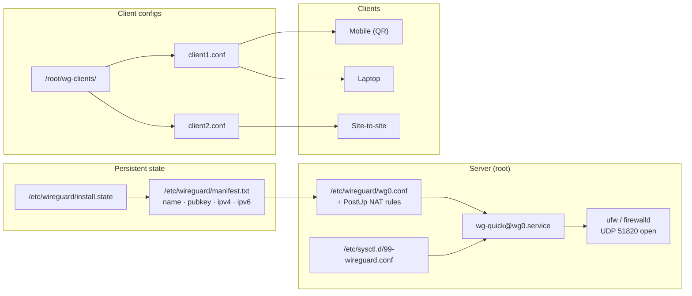

# WireGuard Installer

**Modern, self-contained WireGuard server installer with multi-client management.**

Installs WireGuard, generates keys, writes server and client configs, enables
IP forwarding, opens the firewall, and starts the systemd service — in one
command. Add, remove, list, and inspect clients with dedicated subcommands.
No PPA, no unstable repo, no copr. Uses the kernel module that ships with
every Linux 5.6+ distribution.

**Maintained by [`D0T_SL_CE"I_"`](https://github.com/)**

[](#changelog)
[](#license)
[](#requirements)
[](#)

> ### ⚠️ Defensive tooling only
>
> This script configures the local host's own WireGuard server. It does not
> scan, probe, or send traffic to any remote host. It is a deployment tool,
> not an attack tool.

---

## Table of contents

- [What it does](#what-it-does)
- [Why a rewrite](#why-a-rewrite)
- [Architecture](#architecture)
- [Features](#features)
- [Requirements](#requirements)
- [Install](#install)
- [Usage](#usage)
- [Subcommands](#subcommands)
- [Configuration reference](#configuration-reference)
- [Files created](#files-created)
- [WSL integration](#wsl-integration)
- [Security considerations](#security-considerations)
- [Troubleshooting](#troubleshooting)
- [Changelog](#changelog)
- [Credits](#credits)
- [License](#license)

---

## What it does

```
┌─────────────────────┐     ┌──────────────────┐     ┌─────────────────────┐
│  wireguard-install  │────▶│      wg0.conf    │────▶│  wg-quick@wg0.service│
│     (this script)   │     │  + client configs│     │     (systemd)        │
└─────────────────────┘     └──────────────────┘     └─────────────────────┘
         │                            │                         │
         ▼                            ▼                         ▼
  * package install            * server keys               * IP forwarding
  * OS detection               * client keys               * UDP port open
  * input validation           * PSK (optional)            * interface up
  * firewall open              * QR codes                  * health check
```

On `install`, the script:

1. Detects the OS (Debian, Ubuntu, Fedora, RHEL/Rocky/Alma, Arch).
2. Installs `wireguard-tools`, `iptables`, and `qrencode`.
3. Detects your public IPv4/IPv6 and default interface (pre-fills prompts).
4. Prompts for interface name, WireGuard subnet, port, DNS, and PSK choice.
5. Generates the server key pair.
6. Writes `/etc/wireguard/wg0.conf` with full PostUp/PostDown NAT rules for
   IPv4 **and** IPv6.
7. Persists IP forwarding in `/etc/sysctl.d/99-wireguard.conf`.
8. Opens UDP `$SERVER_PORT` in `ufw` or `firewalld` if either is active.
9. Enables and starts `wg-quick@wg0` and verifies the interface came up.
10. Adds the first client, writes its config to `/root/wg-clients/`, and
    prints a QR code.

---

## Why a rewrite

The original `wireguard-install.sh` was a common starting point circa 2020.
Since then several parts of it have become **unsafe or non-functional**:

| Problem | Why it matters now |
|---|---|
| Writes client config to `$HOME/wg0-client.conf` with default `umask` | Client private key sits in a **world-readable** file. Every local user can steal the VPN identity |
| No firewall rule | Server starts, service reports "active," **no client can connect** on any distro with `ufw`/`firewalld` enabled |
| `ppa:wireguard/wireguard` | PPA archived 2021; install fails on Ubuntu 22.04+ |
| Debian `unstable` repo injection | Pulls unrelated unstable packages into a stable system; pins break package updates |
| `jdoss/wireguard` copr | Only relevant for kernel < 5.6; deprecated on every modern Fedora |
| `dnf install wireguard-dkms` | DKMS is not needed when the module is in-tree since Linux 5.6 |
| `apt-get install wireguard` (no `-y`) | Hangs waiting for `[Y/n]` in unattended runs |
| No `PersistentKeepalive` | NAT'd clients (phones, home routers) silently drop every 30–120 s |
| Default port `1194` | OpenVPN's port; collides on dual-purpose hosts |
| DNS `176.103.130.130/131` (AdGuard) | Retired; does not resolve |
| `iptables -t nat -A` without matching `PostDown` for `FORWARD` | Rules leak on interface restarts |
| No uninstall path | Removing the tool leaves firewall rules, sysctl file, and keys behind |
| Silent failures | No `set -euo pipefail`; errors are swallowed |
| CentOS-only for RHEL family | Rocky, AlmaLinux, RHEL 8/9 not recognized |
| No input validation | Any string is written into `iptables` and config files |

This rewrite fixes every one of those, plus adds client management
subcommands that the original lacked entirely.

---

## Architecture



### Flow on `add-client`

```mermaid
sequenceDiagram
    participant U as Operator
    participant S as wireguard-install.sh
    participant M as manifest.txt
    participant C as wg0.conf
    participant W as wg (kernel)

    U->>S: add-client laptop
    S->>M: read existing peers
    S->>S: next_client_ip() → .2, ::2
    S->>S: wg genkey; wg pubkey
    S->>S: wg genpsk (if USE_PSK=y)
    S->>C: append [Peer] block
    S->>M: append laptop|pubkey|10.66.66.2|fd42:42:42::2
    S->>S: render /root/wg-clients/laptop.conf (0600)
    S->>W: wg set wg0 peer <pub> allowed-ips ...
    S->>U: print config + QR code
```

No interface restart — the peer is added live via `wg set`, so existing
clients never lose their session when a new one joins.

---

## Features

| Category | Feature |
|---|---|
| **Correctness** | Client private key file `chmod 0600` |
| | `set -euo pipefail` + `umask 077` |
| | Input validation on every field (`is_ipv4` / `is_ipv6` / `is_port` / `is_iface`) |
| | `PersistentKeepalive = 25` in every client config |
| | Default port `51820` (WireGuard convention) |
| | Default DNS `1.1.1.1 / 1.0.0.1` (Cloudflare — stable, fast) |
| **Networking** | Full IPv4 + IPv6 PostUp/PostDown NAT rules |
| | IP forwarding persisted to `/etc/sysctl.d/99-wireguard.conf` |
| | Firewall opened automatically (`ufw` or `firewalld`) |
| | Firewall closed on `uninstall` |
| | Health check after start (fails loudly if the interface didn't come up) |
| **Client management** | `add-client`, `remove-client`, `list-clients`, `show-client` |
| | Auto-assign next available IPv4/IPv6 |
| | Live peer add/remove via `wg set` (no restart) |
| | QR code generation for mobile clients |
| | Per-client `manifest.txt` as source of truth |
| **Safety** | Backup existing configs before overwrite |
| | Confirm before uninstall |
| | `uninstall` removes config, firewall rule, sysctl, state, and client files |
| **Modernisation** | No PPA, no unstable repo, no copr |
| | Kernel 5.6+ uses the in-tree module |
| | Rocky / AlmaLinux / RHEL 8+ supported |
| | `DEBIAN_FRONTEND=noninteractive` for apt |
| **Support** | Coloured output, subcommands with `--help`, `--version` |
| | Author attribution in header, config comment, and `--version` |

---

## Requirements

| Component | Minimum | Notes |
|---|---|---|
| Linux kernel | **5.6+** | WireGuard is in-tree since 5.6. Older kernels need `wireguard-dkms` (not covered here) |
| `bash` | 4.3+ | `set -euo pipefail`, arrays |
| **systemd** | any | Service is `wg-quick@<iface>.service` |
| `iptables` | any | `iptables-nft` on modern distros works transparently |
| `wg` / `wg-quick` | 1.0+ | Installed by the script |
| `qrencode` | optional | QR codes; falls back to text output if absent |
| `ufw` or `firewalld` | optional | Port opened automatically if active |

### Supported distributions

| Family | Versions |
|---|---|
| Debian | 11 (Bullseye), 12 (Bookworm), 13 (Trixie) |
| Ubuntu | 20.04, 22.04, 24.04, 24.10 |
| Fedora | 38+ |
| RHEL family | RHEL 8, RHEL 9, Rocky 8/9, AlmaLinux 8/9 |
| Arch | rolling |

Anything with systemd and kernel 5.6+ should work. OpenVZ and LXC are
explicitly refused (kernel module is on the host, not in the container).

---

## Install

```bash
# As root on the server:
sudo ./wireguard-install.sh install
```

The installer is **interactive**. It will prompt for:

| Prompt | Default | Notes |
|---|---|---|
| Public address (IPv4 or IPv6) | auto-detected | What clients connect to |
| Public interface | auto-detected | The NIC with the default route |
| WireGuard interface name | `wg0` | Must match `[a-zA-Z0-9_-]{1,15}` |
| Server WireGuard IPv4 | `10.66.66.1` | Inside the tunnel |
| Server WireGuard IPv6 | `fd42:42:42::1` | Inside the tunnel |
| WireGuard UDP port | `51820` | Open in firewall automatically |
| Client primary DNS | `1.1.1.1` | Cloudflare |
| Client secondary DNS | `1.0.0.1` | Cloudflare |
| Use pre-shared key | `Y` | Adds post-quantum resistance for symmetric phase |
| First client name | `client1` | Any alnum/-/_ up to 32 chars |

After install:

- Server config: `/etc/wireguard/wg0.conf` (mode `0600`)
- First client config: `/root/wg-clients/client1.conf` (mode `0600`)
- Service: `wg-quick@wg0.service` — enabled and running
- Firewall: UDP `51820` open
- Sysctl: `/etc/sysctl.d/99-wireguard.conf`

---

## Usage

```text
wireguard-install.sh <command> [args]

Commands:
  install                  Install WireGuard and add the first client
  add-client <name>        Add a new client
  remove-client <name>     Remove a client
  list-clients             List all clients (name, IPv4, IPv6, pubkey)
  show-client <name>       Show client config and QR code
  uninstall                Remove config and firewall rules
  version                  Print version
  help                     Print this help
```

### Typical workflows

**Add a laptop:**

```bash
sudo ./wireguard-install.sh add-client laptop
# Output includes the config and a QR code for the WireGuard mobile app.
```

**Add a phone:**

```bash
sudo ./wireguard-install.sh add-client phone
# Scan the QR code with the WireGuard Android/iOS app.
```

**Copy config to a client machine:**

```bash
# From the client:
scp root@server:/root/wg-clients/laptop.conf ~/wg0.conf

# Install WireGuard on the client and use it:
sudo install -m 0600 ~/wg0.conf /etc/wireguard/wg0.conf
sudo wg-quick up wg0
```

**Inspect the server's live state:**

```bash
sudo wg show
sudo wg showconf wg0
```

**Rotate or revoke a client (e.g. a stolen laptop):**

```bash
sudo ./wireguard-install.sh remove-client laptop
# Peer is removed from the kernel immediately via wg set.
# Config, manifest entry, and client file are removed.
```

**Re-provision a removed client's slot:**

The next `add-client` reuses the lowest free `.N` address, so if you remove
`laptop` (`.2`) and add `tablet`, tablet gets `.2`.

---

## Subcommands

### `install`

Runs the full interactive installer. Safe to re-run — if configs already
exist, it offers to back them up (`*.bak.<timestamp>`) before proceeding.

### `add-client <name>`

- Validates the name (`^[a-zA-Z0-9_-]{1,32}$`)
- Assigns the next free IPv4/IPv6 in the tunnel subnet
- Generates a fresh key pair, plus PSK if enabled at install time
- Appends a `[Peer]` block to the server config
- Records the peer in `manifest.txt`
- Writes `/root/wg-clients/<name>.conf` (mode `0600`)
- Adds the peer to the running interface via `wg set` (**no restart**)
- Prints the config and a QR code

### `remove-client <name>`

- Removes the peer from the kernel via `wg set ... remove`
- Strips the `[Peer]` block from the server config (using a keyed `awk`)
- Removes the entry from `manifest.txt`
- Deletes `/root/wg-clients/<name>.conf`
- **Does not touch the running interface's other peers**

### `list-clients`

Reads `manifest.txt` and prints:

```
NAME                 IPv4             IPv6                         PUBLIC KEY
----                 ----             ----                         ----------
laptop               10.66.66.2       fd42:42:42::2                aBcD...=
phone                10.66.66.3       fd42:42:42::3                eFgH...=
```

### `show-client <name>`

Prints the client config file and, if `qrencode` is installed, the QR code.

### `uninstall`

- Stops and disables `wg-quick@wg0`
- Closes UDP `51820` in the firewall
- Removes `wg0.conf`, `/root/wg-clients/`, `manifest.txt`, `install.state`,
  and `/etc/sysctl.d/99-wireguard.conf`
- **Leaves the WireGuard packages installed**

Prompts for confirmation before doing anything.

---

## Configuration reference

There is **no config file to edit** — everything is set at install time and
persisted to `/etc/wireguard/install.state`. The state file is `0600` and
looks like:

```bash
# Managed by wireguard-install.sh 2.0.0
# Do not edit manually.
SERVER_WG_NIC="wg0"
SERVER_WG_IPV4="10.66.66.1"
SERVER_WG_IPV6="fd42:42:42::1"
SERVER_PORT="51820"
SERVER_PUB_IP="203.0.113.5"
SERVER_PUB_NIC="eth0"
CLIENT_DNS_1="1.1.1.1"
CLIENT_DNS_2="1.0.0.1"
USE_PSK="y"
```

To change server parameters:

```bash
sudo ./wireguard-install.sh uninstall
sudo ./wireguard-install.sh install
```

Client parameters (DNS, AllowedIPs, Keepalive) live in each client's
`/root/wg-clients/<name>.conf`. Edit the file and re-deliver it to the
client — the server does not need to change.

---

## Files created

```text
/etc/wireguard/
├── wg0.conf                 0600  server config (keys, peers, NAT rules)
├── manifest.txt             0600  name|pubkey|ipv4|ipv6 per client
└── install.state            0600  install-time parameters

/root/wg-clients/
├── client1.conf             0600  per-client config
├── laptop.conf              0600
└── phone.conf               0600

/etc/sysctl.d/99-wireguard.conf       IP forwarding (v4 + v6)
```

Backups created on reinstall:

```text
/etc/wireguard/wg0.conf.bak.20250115T143022Z
```

Nothing is written outside these paths, `iptables`/`ip6tables` rules, and
the WireGuard packages themselves.

---

## WSL integration

If you are running this installer **inside WSL 2** to expose a WireGuard
endpoint from a Windows host, additional configuration is required. WSL 2
runs in a lightweight VM with its own network namespace, and inbound traffic
does not automatically reach it.

### Scenario A — WSL as a client (recommended)

Running WireGuard as a **client** inside WSL works normally: `wg-quick up wg0`
brings up the tunnel inside the VM, and processes running in WSL route
through it. Windows processes do **not** — for system-wide VPN on Windows,
use the official WireGuard for Windows client instead. See the
[WireGuard Windows install guide](https://www.wireguard.com/install/).

### Scenario B — WSL as a server (advanced)

If you want Windows apps to be reachable over the tunnel from a remote
client, you must bridge Windows → WSL 2:

1. **Find the WSL 2 IP:**

   ```powershell
   wsl hostname -I
   ```

2. **Open the WireGuard port in Windows Firewall** (run as Administrator):

   ```powershell
   netsh advfirewall firewall add rule name="WireGuard WSL UDP" `
     dir=in action=allow protocol=UDP localport=51820 localip=<WSL_IP>
   ```

3. **Port-forward on your home router** to the Windows host's LAN IP on UDP
   `51820` — WSL 2 has no public IP of its own.

4. **Forward Windows → WSL on every boot.** The WSL 2 IP changes on restart,
   so a `netsh interface portproxy` rule must be refreshed. Common pattern:

   ```powershell
   # Run as Administrator after each WSL start:
   $wslIp = (wsl hostname -I).Trim().Split(' ')[0]
   netsh interface portproxy add v4tov4 `
     listenport=51820 listenaddress=0.0.0.0 `
     connectport=51820 connectaddress=$wslIp protocol=udp
   ```

   Because `netsh portproxy` has limited UDP support, most operators use a
   small relay or the official WireGuard for Windows client with the config
   generated by this installer. That is simpler and more reliable.

### WSL prerequisites

- Windows 10 build 19041+ or Windows 11
- WSL 2 enabled (`wsl --install`)
- Virtualization enabled in BIOS/UEFI
- Ubuntu 22.04 LTS or later recommended

```powershell
wsl --install
wsl --set-default-version 2
```

Inside WSL:

```bash
sudo apt update && sudo apt upgrade -y
# Then run this installer normally.
```

---

## Security considerations

This section replaces the "LOCK/CODE defi LaYs" discussion from the original
DotMob tutorial, restructured as concrete practices for this installer.

### 1. Key management

- Client private keys live in `/root/wg-clients/` at mode `0600`. Only root
  can read them.
- Server private key lives in `/etc/wireguard/wg0.conf` at mode `0600`.
- **Never** copy these files to a shared location, never commit them to git,
  and never paste them into a chat or ticket.
- To rotate a client: `remove-client <name>` then `add-client <name>`. The
  new key is generated locally; nothing leaves the server.
- To rotate the server: `uninstall` then `install`. **All existing clients
  must be re-provisioned** — schedule this deliberately.

### 2. Least privilege

- The script requires root for `ipset`, `iptables`, and writing to
  `/etc/wireguard/`. There is no way to reduce that.
- Do **not** run the installer from an untrusted checkout. Read the script
  first, or verify its hash against the version you published.
- The daemon/service it creates (`wg-quick@wg0`) runs as root for the same
  reasons. Its scope is limited to network configuration.

### 3. Firewall hardening

Beyond opening UDP `51820`, restrict everything else:

```bash
# ufw example — default deny inbound, allow only SSH + WireGuard
sudo ufw default deny incoming
sudo ufw default allow outgoing
sudo ufw allow 22/tcp          # or your alternate SSH port
sudo ufw allow 51820/udp       # already done by this installer
sudo ufw enable
```

On `firewalld` systems, use a dedicated zone with only `ssh` and
`wireguard` services. Do not expose the WireGuard port on a public
interface that also hosts other services unless you intend to.

### 4. Regular updates

WireGuard itself rarely needs updating (it is in the kernel), but keep:

- The host OS patched (`apt upgrade` / `dnf upgrade`)
- `iptables` updated (rules syntax evolves slowly, but bugs exist)
- The kernel updated (WireGuard fixes ship via kernel updates)

```bash
# Debian / Ubuntu:
sudo apt update && sudo apt upgrade -y
# RHEL family:
sudo dnf upgrade -y
```

### 5. Logging and monitoring

```bash
# Live interface state
sudo wg show

# Service logs
sudo journalctl -u wg-quick@wg0 -f

# Recent handshakes per peer
sudo wg show all latest-handshakes
```

A peer whose "latest handshake" is older than `5 minutes` while the service
is up is either idle or broken. A peer whose handshake keeps resetting
against an endpoint you do not recognize is a sign of key compromise —
`remove-client` that peer immediately.

### 6. DNS security

The default DNS in every client config is Cloudflare (`1.1.1.1`,
`1.0.0.1`). This is fast, stable, and does not log query bodies for more
than 24 hours.

For stricter privacy requirements:

- Use a self-hosted resolver (Pi-hole, Unbound, AdGuard Home) as the client
  DNS. Add its tunnel IP (e.g. `10.66.66.10`) to the client config's `DNS=`
  field.
- On Windows and macOS clients, additionally configure DNS-over-HTTPS or
  DNS-over-TLS at the OS level so that queries made **outside** the tunnel
  are encrypted too. WireGuard does not encrypt DNS by itself.

Never use a DNS resolver you cannot name and trust. Every client in the
tunnel will route its queries through whatever you put in that field.

### 7. Pre-shared keys (PSK)

The installer defaults to `USE_PSK=y`, generating a 32-byte symmetric key per
client and writing it into both the server `[Peer]` block and the client
`[Peer]` block.

PSKs add a symmetric layer that is believed to be resistant to
post-quantum attacks on the asymmetric handshake — a defence-in-depth measure,
not a replacement for key hygiene. Leave it on unless you have a specific
reason to disable it.

### 8. Attack surface

The installer only touches:

- `/etc/wireguard/`
- `/etc/sysctl.d/99-wireguard.conf`
- `/root/wg-clients/`
- `iptables` and `ip6tables` NAT/FORWARD chains
- The system firewall's UDP rule for `$SERVER_PORT`

It does **not** modify SSH config, user accounts, cron jobs, or any other
service. Verify this with `git diff` or by reading the script — that is the
point of a single-file installer.

---

## Troubleshooting

| Symptom | Likely cause | Fix |
|---|---|---|
| `wg-quick@wg0` fails to start | `wg0.conf` syntax error | `sudo journalctl -u wg-quick@wg0 -n50` |
| Service active, no client connects | Firewall not open | `sudo ufw status` / `sudo firewall-cmd --list-ports` |
| Client connects, no internet | IP forwarding off | `sysctl net.ipv4.ip_forward` should be `1` |
| Client connects, no internet (NAT) | Missing `MASQUERADE` rule | `sudo iptables -t nat -L POSTROUTING -n -v` |
| `add-client` says "no install state" | Never ran `install` | `sudo ./wireguard-install.sh install` |
| IPv6 tunnel broken | `/etc/sysctl.d/99-wireguard.conf` not loaded | `sudo sysctl -p /etc/sysctl.d/99-wireguard.conf` |
| Handshake succeeds, no traffic | Wrong `AllowedIPs` on client | Check `AllowedIPs` in client config |
| Reinstall detects existing config | Previous install present | Confirm backup prompt, or `uninstall` first |
| `qrencode: command not found` | Package missing | `sudo apt install qrencode` (or your distro's equivalent) |

Debugging one client's handshake without disrupting others:

```bash
# Show every peer, most recent handshake first
sudo wg show all latest-handshakes | sort -k2 -n -r

# Show only one peer
sudo wg show wg0 peers
sudo wg show wg0 transfer
```

---

## Changelog

### v2.0.0 — first release under the new installer

**Thirteen correctness and safety fixes over the original script:**

| # | Bug | Fix |
|---|---|---|
| 1 | Client config world-readable | `chmod 0600` + `/root/wg-clients/` + `umask 077` |
| 2 | No firewall rule → unreachable server | Auto-detect and open `ufw`/`firewalld` |
| 3 | `set -euo pipefail` absent | Added |
| 4 | No input validation | `is_ipv4` / `is_ipv6` / `is_port` / `is_iface` |
| 5 | No `PersistentKeepalive` | `25` on every client |
| 6 | Default port `1194` | `51820` (WireGuard convention) |
| 7 | PPA / unstable / copr repos | Removed — kernel 5.6+ in-tree |
| 8 | apt hangs on prompts | `DEBIAN_FRONTEND=noninteractive` + `-y` |
| 9 | Silent overwrite of existing config | Backup prompt with `.bak.<timestamp>` |
| 10 | Server private key left in memory | Wiped after write |
| 11 | IPv6 forwarding not applied until reboot | Applied via `sysctl -p` at install |
| 12 | No uninstall path | `uninstall` subcommand |
| 13 | CentOS only for RHEL family | Rocky, AlmaLinux, RHEL 8/9 |

**New features:**

- Subcommands: `install`, `add-client`, `remove-client`, `list-clients`,
  `show-client`, `uninstall`, `version`, `help`
- Persistent state at `/etc/wireguard/install.state` and `manifest.txt`
- Auto-assigned next free client IPv4/IPv6
- Live peer add/remove via `wg set` (no interface restart)
- QR code generation for mobile clients
- Full IPv4 + IPv6 PostUp/PostDown rules
- Health check after start
- Default DNS changed from deprecated AdGuard (`176.103.130.130`) to
  Cloudflare (`1.1.1.1`)
- Coloured output, `--version` with author
- Author attribution in header, config comment, and help

**Files:**

| File | Change |
|---|---|
| `wireguard-install.sh` | rewrite — full subcommand structure, safety fixes |
| `README.md` | new — this file |

---

## Credits

The original single-file WireGuard installer that this is based on has been
widely forked; the concept (interactive prompts → key generation →
`wg-quick` service) is not unique to any one author. This rewrite keeps that
concept and modernizes the delivery, safety, and client management.

The WSL integration notes are adapted from DotMob's original WSL + WireGuard
tutorial, restructured as concrete practices rather than tutorial prose.

---

## License

MIT — see `LICENSE`. Choose and commit a license file before publishing.

---

<p align="center">
  <strong>WireGuard Installer</strong> — keys, configs, and clients in one command.<br/>
  <sub>Maintained by <code>SL_CE"I_"</code> · MIT License</sub>
</p>
